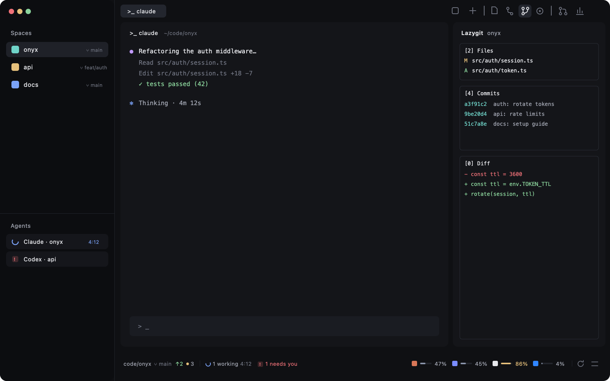

# Onyx-Git

A git-first layout for the [Herdr](https://herdr.dev) desktop app: your coding agents in the middle, git one click away on the right, and a quiet bottom strip that tells you where you are, what your agents are doing, and how much plan quota each of them has left.



## What's in it

- **Spaces with their branch.** Every space shows its branch with a branch icon, `main` included, plus ahead/behind.
- **One quiet toolbar.** Icon-only buttons, names on hover, in three groups: tabs (agent view, new) · side panels (Files, Changes, Lazygit, Issues) · Pull requests and Insights.
- **Side panel.** Files, a Zed-style git panel (stage, commit, stash, push, commit graph), a live lazygit per space, and the repo's GitHub issues.
- **Bottom-left: where you are and what's running.** The focused pane's folder, branch, ↑ahead ↓behind and changed files; then `2 working 12:04` (with the longest-running agent's clock), `1 needs you`, `done` and `idle`. Click it to jump to the agent that needs you.
- **Bottom-right: quota, Orca-style.** One slim bar and percentage per provider — Claude, Codex, Cursor, Copilot, Antigravity, Grok, Kimi, OpenCode, Z.AI and more. Hover for every window and its reset; click for an overview sorted tightest first; the slider button picks providers and switches between **% used** and **% left**. Amber from 80 % used, red from 95 %.
- **Tabs with timers.** A tab whose agent is working shows how long it has been at it.
- **Onyx theme.** A deep blue-black dark theme (light mode falls back to Herdr's Paper).

## Install

```sh
git clone https://github.com/Grabbitz/Onyx-Git.git
cd Onyx-Git
./install.sh
herdr-app do layout.switch --name onyx-git
```

The installer copies the layout, theme and mods into `~/.config/herdr-app` (or `$HERDR_APP_HOME`), fetches the panels it uses from their authors' repos, merges `keys.json`, and runs `herdr-app check` on every mod. It never overwrites a mod it didn't put there; Onyx-Git's own `onyx-*` mods are updated in place, so `git pull && ./install.sh` updates it. `ctrl-shift-l` switches back to any other layout.

**Needs:** Herdr, `git`, `python3`. For the panels: [`quota-axi`](https://github.com/kunchenguid/quota-axi) (`npm i -g quota-axi`), [`lazygit`](https://github.com/jesseduffield/lazygit), and the GitHub CLI `gh` signed in.

**Keychain (macOS):** Claude Code, Cursor and Copilot keep their sign-in in the Keychain. Click the provider in the quota overview → **Allow Keychain** → *Always Allow*, once.

## Keys

| Key | Does |
| --- | --- |
| `cmd-shift-b` | Sidebar: Spaces + Agents ↔ Focus |
| `cmd-shift-a` | Agent view on/off |
| `cmd-shift-s` | Settle the agent in view (Focus) |

## What it runs

- `onyx-spaces`, `onyx-status`: read-only `git status` / `git rev-parse` in your spaces' folders.
- `onyx-quota`: `quota-axi --json` every 2 minutes (one call for all providers). quota-axi reads each agent's local sign-in and asks that provider's own usage endpoint; nothing goes anywhere else. It finds `node` and `quota-axi` through your login shell once.
- The fetched panels run what their READMEs say (`gh`, `lazygit`, `git`, a local Node helper for Insights).

## Credits

Built on [herdr-t3](https://github.com/JinJieBeWater/herdr-t3) by JinJieBeWater, itself built on Herdr's shipped mods. Panels by [jankeesvw](https://github.com/jankeesvw/herdr-issues), [o101k](https://github.com/o101k/herdr-lazygit), [aBER0724](https://github.com/aBER0724/herdr-git-changes), [GaganSD](https://github.com/GaganSD/coding-agent-toolkit) and [mrolafsson](https://github.com/mrolafsson/herdr-github). Quota via [quota-axi](https://github.com/kunchenguid/quota-axi). The quota strip's look follows [Orca](https://www.onorca.dev)'s usage tracking. See [NOTICE](NOTICE).

[RECIPE.md](RECIPE.md) is the brief to rebuild it from scratch. Apache-2.0.
