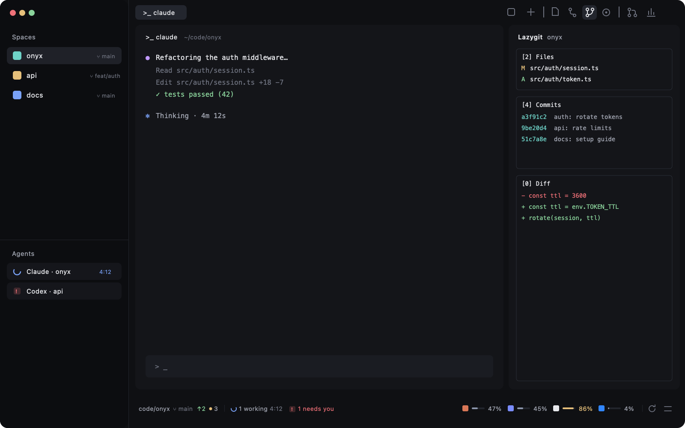

# Onyx-Git

A git-first Herdr layout: spaces and agents on the left, the active tab's terminals in the middle, a switchable side panel of git tools on the right, and a 28px bottom strip — the focused pane's git and the agents' activity on the left, every provider's plan quota on the right. Dark "Onyx" theme.

## What you see

Left to right, top to bottom:

- **Sidebar, 268px, `chrome`.** herdr-t3's chrome (40px brand row with the Focus/Spaces switch and hide button), then Spaces over Agents (or the Focus list), then a 41px footer. Each space row ends with `⑂ <branch>` in 11px `dim` — the branch icon `mods/workspace-chrome/branch.svg` at 11px, `main`/`master` included; ahead `↑n` in `ansi2`, behind `↓n` in `ansi1`.
- **Tab bar, 40px, `chrome`.** Pill tabs (28px, radius 6, `selected` when active). A working tab shows a spinner and its elapsed working time (`42s`, `3:07`, `1:02:09`) in 11.5px `working`. On the right, icon-only 26px buttons (15px icons, `dim`, `hover` background, tooltip names): Agent view · New │ Files · Changes · Lazygit · Issues │ Pull requests · Insights. Groups are split by a 1×14px `border` hairline. The button of the open side panel sits on `selected`.
- **Work area.** herdr-t3's framed panes (radius 8, 28px header) in a stack with the one-agent view; padding [2, 8], gap 8.
- **Side panel, 368px (280–900), hidden by default.** A stack: `files`, `changes` (git-changes), `lazygit` (a 30px lazygit-panel bar over a terminal block), `issues`.
- **Bottom strip, 28px, `chrome`, no border.** Left block (weight 1): `Collab/project ⑂ main ↑2 • 3` in 11px `muted` (the dot is 5px `ansi3`), a 1×12 hairline, then agents: spinner + `2 working` + the longest clock in `dim`; a 14px `blocked` "!" badge + `1 needs you` in `blocked`; a 6px `done` dot + `n done`; a 7px hollow `dim` ring + `n idle`. Parts with nothing to say are absent. Right block (600px): per enabled provider a 22px chip — 12px icon, 24×3 bar, 28px-wide % in 11px `muted` (amber `ansi3` ≥ 80 % used, `blocked` ≥ 95 %) — then a hairline, then 22px refresh and settings buttons with 13px stroke icons, `dim`.

## How it behaves

- **Agent statuses:** working = spinner (`working`, spin 900 ms) and a live clock; blocked = red "!" badge; done = green dot; idle = hollow ring. Clicking the strip's agent part runs `agent.focus` on the blocked agent, else the longest-working, else a done, else an idle one.
- **Git strip** reads `git status --porcelain=v2 --branch` in `focused().cwd` (on the space's machine) when the focused folder changes and every 5 s.
- **Quota** polls once per 2 min: `node quota-axi --provider <enabled> --json --max-age 60s`. First run enables every provider quota-axi reports as set up. Hover a chip for every window with its reset countdown; click for the overview popup (400px wide, providers sorted by their tightest window, each window a 170×5 bar); a provider whose read needs the Keychain shows **Allow Keychain**, which re-reads it with `--allow-keychain-prompt`. The settings popup lists every provider with a switch and its tightest %, and a Used/Left segmented control; the mode changes every number and bar, colours always follow % used.
- **Side panel buttons** run `layout.select {stack: "panel-body", child}` + `layout.show {id: "panel"}`, or `layout.hide` when already open. Pull requests runs `mod.open gh-prs`; Insights focuses this space's Insights tab or opens one (`tab.new {mod: "insights"}`).
- Keys (`layout:onyx-git`): `cmd-shift-b` t3-chrome.sidebar, `cmd-shift-a` onyx-tabs.view, `cmd-shift-s` t3-focus.settle.

## Built from

- `layouts/onyx-git.json`: herdr-t3's tree with `onyx-tabs`, `onyx-spaces`, the `panel` column and a `status` row of `onyx-status` (weight 1, min 120) + `onyx-quota` (600px). Root theme `{light: "paper", dark: "onyx-git"}`, preview `layouts/onyx-git.png`.
- `themes/onyx-git.json`: background `#141519`, canvas `#0f1013`, chrome `#0c0d10`, accent `#8b95ab`, working `#7aa2f7`, blocked `#f07178`, done `#8bd49c`.
- `mods/onyx-tabs`, `mods/onyx-spaces`: herdr-t3's t3-tabs and t3-spaces with the changes above. `mods/t3-*`: herdr-t3, unchanged.
- `mods/onyx-status`: `exec`, `spaces`, `agents`, `focused`, `run`, `theme`, `home`; a 5 s git timer and a 1 s redraw only while a tab has `working_since`.
- `mods/onyx-quota`: one view, `props().view` = none (strip) / `"overview"` / `"picker"`; shared keys `onyx-quota.data`, `onyx-quota.on`, `onyx-quota.mode`. Only the strip polls. Icons from Herdr's `icons/`.
- Fetched by `install.sh`: `issues`, `git-changes`, `insights`, `lazygit-panel` (its layout-name check widened to `onyx-git`), `herdr-github`'s app mod installed as `gh-prs` (asset and back-link paths renamed).

## Watch out

- Herdr's `exec` PATH often lacks nvm/volta: onyx-quota asks `$SHELL -lic "command -v node; command -v quota-axi"` once and runs `node <quota-axi.js>` directly.
- A mod whose `mod.json` says `"place": "right"` gets docked into whatever layout is showing when it is first seen; Onyx-Git's mods all say `"none"`.
- `herdr-app check` only renders a mod's default view — check `overview` and `picker` by forcing `this.view`.
- `flex_shrink` takes a value; a local variable named like a module helper shadows it inside `render`.
- lazygit-panel only acts while `shared("layout")` is one it knows.

## Done when

- `./install.sh` into an empty `HERDR_APP_HOME` copies 4 onyx mods, 5 t3 mods and 5 fetched panels, and every `herdr-app check` passes.
- `node tests/onyx-quota.test.mjs` and `node tests/onyx-status.test.mjs` pass.
- In the app: spaces show `⑂ main`; the toolbar has 8 icon buttons in 3 groups; each panel button opens its page; the bottom-left shows the focused repo's branch and changed count and, with an agent working, its clock; the bottom-right shows one chip per set-up provider and the Used/Left switch flips every number.
